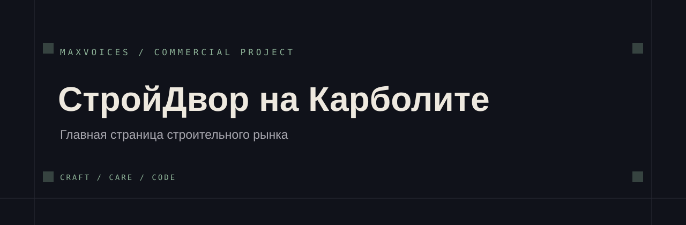
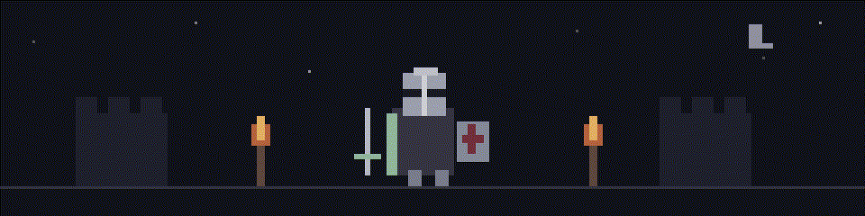
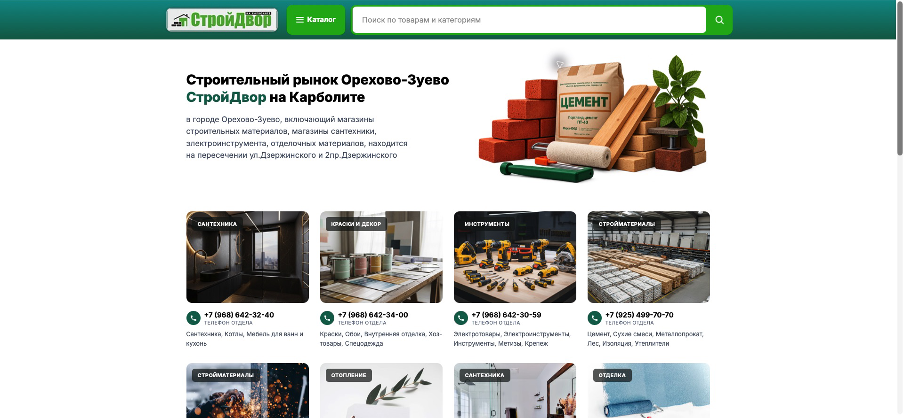

<p align="center"></p>
<p align="center"></p>
<p align="center"><sub>Из мастерской Максима Голосова · MaxVoices</sub></p>

# СтройДвор на Карболите

Редизайн главной страницы строительного рынка в Орехово-Зуево. **Оплаченный клиентский заказ**: представить ассортимент, выделить предложения и сделать навигацию по категориям заметной с первого экрана.

| Контекст | Детали |
| :--- | :--- |
| Формат | Коммерческий заказ, оплаченная работа |
| Разработка | Максим Голосов, с помощью ИИ |
| Основа | Макет редизайна главной страницы в Figma |
| Технологии | HTML, CSS / LESS, JavaScript, jQuery |

<p><a href="https://www.figma.com/design/Abd5fZcxy8Z6p4l0gG4wWu/?node-id=0-1">Открыть макет в Figma ↗</a></p>

**[Открыть сайт ↗](https://stroydvor.vercel.app)**

## Интерфейс



## Что представлено

- Первый экран с позиционированием рынка и строительными материалами.
- Раскрывающееся меню каталога с группировкой разделов.
- Карточки категорий и информационные блоки о рынке.
- Адаптивные стили для разных размеров экрана.
- Исходный LESS и готовый CSS для запуска без сборки.

Это фронтенд главной страницы. Некоторые ссылки и карточки используют демонстрационные переходы; полноценный интернет-магазин и серверная обработка в этот репозиторий не входят.

## Структура

```text
index.html        Главная страница
style.less        Исходные стили
style.css         Готовые стили для браузера
script.js         Поведение меню каталога
js/               Локальная копия jQuery
img/              Графические материалы
 docs/assets/     Оформление портфолио
```

При изменении LESS нужно отдельно обновить CSS. Для просмотра готовой версии компиляция не требуется.

## Запустить локально

Нужен Python 3. Из корня проекта:

```bash
python3 -m http.server 8080 --bind 127.0.0.1
```

Откройте **http://127.0.0.1:8080**. Остановка сервера: `Ctrl+C`.

## Разместить сайт

Это статический сайт. Для Vercel импортируйте репозиторий, выберите **Other**, оставьте команду сборки пустой и используйте корневую папку как Output Directory. Секреты и переменные окружения для этой версии не требуются.

Действующий сайт: **https://stroydvor.vercel.app**. Ссылка предоставлена автором проекта.

## Автор

**Максим Голосов / MaxVoices** · [GitHub](https://github.com/MaxVoicesDeveloper) · [Связаться](https://t.me/MaxVoicesDeveloper)

Оформление README и оригинальная пиксельная анимация подготовлены с помощью ИИ. Участие ИИ в документации не меняет авторство и историю разработки самого проекта.

<sub>Клиентские названия, логотипы, фотографии и другие материалы принадлежат соответствующим правообладателям. Публикация в портфолио не предоставляет право использовать их в других коммерческих проектах.</sub>
